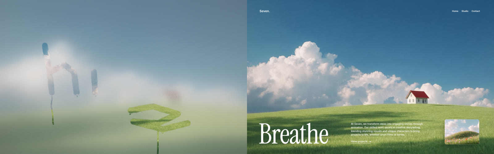
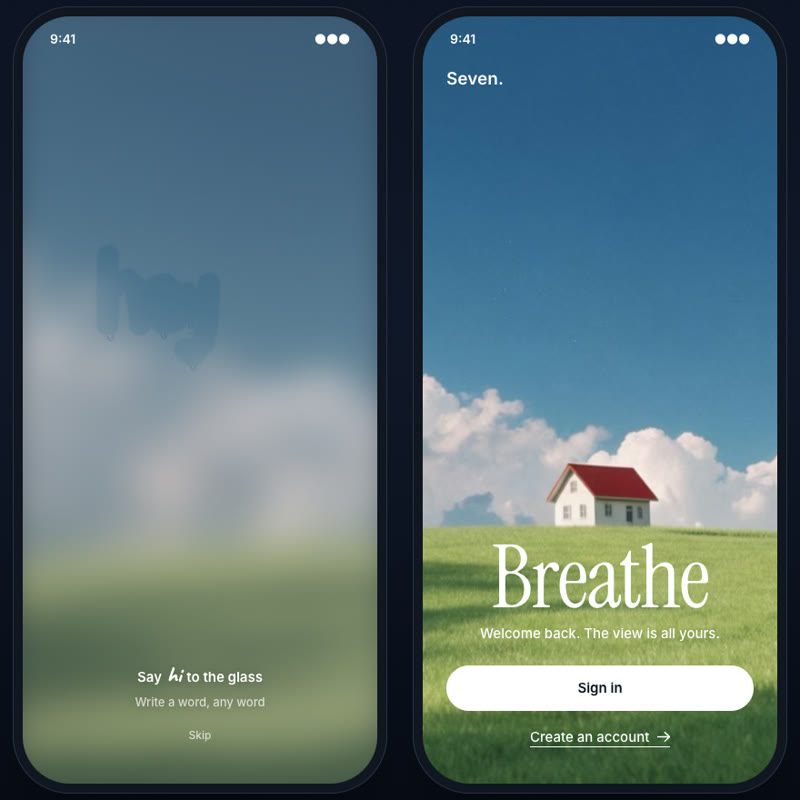

# Fogged Glass

A fogged-up window you wipe with your finger. Water gathers where your stroke ends and runs down, and the glass slowly fogs back up.



**[Play with it on picker.studio](https://picker.studio/tools/fogged-glass)**: a landing page you open by finding a house in the fog, and an app screen you unlock by writing a word on the glass.

This repo is the engine behind it: one JavaScript file, WebGL2, no dependency, 18 KB gzipped. Drop it in a page as a `<fogged-glass>` element, put a photo or a looping video behind it, and listen for the moment the visitor gets through.

## What makes it read as glass

- **Fog, not blur.** The view is blurred, lifted and muted the way light scatters in condensation, a little thicker low on the pane, never even. Warm lights bloom through it.
- **The finger pushes water aside.** Every stroke is clean in the middle and lined with fine droplets on its edges.
- **Drops come from your strokes.** The water you push runs down your stroke to its lowest points, the foot of a letter, the belly of a curve. A long stroke drips and runs; a short one keeps a bead. Running drops meander, stop and go, merge, and show the scene upside down like tiny lenses.
- **It fogs back up**, in patches, after a while.

## Quick start

```html
<fogged-glass data-src="view.mp4" data-poster="view.jpg" style="position:fixed; inset:0"></fogged-glass>

<script type="module" src="https://cdn.jsdelivr.net/gh/JuPicker/fogged-glass@1.0.0/fogged-glass.js"></script>
```

Or download `fogged-glass.js` and host it yourself. The element fills the box you give it. Behind the glass, use a still image (`data-src="view.jpg"`) or a muted looping video with a poster.

## Two recipes

### Find it, then reveal the page

```html
<fogged-glass id="glass" data-src="hills.mp4" data-poster="hills.jpg"
  data-target="0.675,0.565,0.095,0.11" data-threshold="0.5"></fogged-glass>

<script type="module">
  import "./fogged-glass.js";
  const glass = document.getElementById("glass");
  glass.addEventListener("fogreveal", () => {
    glass.clearAll(1.8);                 // the fog evaporates and stays gone
    document.body.classList.add("revealed");
  });
</script>
```

`data-target` is the thing to find, as a rectangle in media coordinates (x, y, width, height, 0 to 1, y down), so it follows the crop on every screen. Without a target, the reveal fires once `data-threshold` of the whole glass is wiped. Full example: [`examples/find-and-reveal.html`](examples/find-and-reveal.html).

### Write a word to unlock



```html
<fogged-glass id="glass" data-src="hills.mp4" data-goal="write" data-brush="15"></fogged-glass>
```

The visitor writes anything, freehand. When the finger lifts and pauses, the strokes are checked: a word unlocks, a swipe, a circle, a cross or a scrub over the whole glass does not, and `fogwrite` tells you why (`small`, `big`, `simple`) so you can nudge. It is a shape test, not handwriting recognition: any word goes, so nobody gets stuck at the door. Full example: [`examples/write-to-unlock.html`](examples/write-to-unlock.html).

## Attributes

Everything is optional. Most attributes can change at any time, the engine reads them every frame; changing `data-src`, `data-poster` or `data-ghost` reloads what they point to.

| Attribute | Default | |
|---|---|---|
| `data-src` | | The view: an image, or a video (`.mp4`, `.webm`, `.mov`, `.m4v`) played muted and looped. |
| `data-poster` | | Still shown while the video loads, without WebGL2, and with reduced motion. |
| `data-focus` | `0.5,0.5` | The point of the media kept in view when it is cropped, like `object-position`. |
| `data-zoom` | `1` | Crop tighter than `object-fit: cover`. |
| `data-refog` | `14` | Seconds for a wiped patch to fog back up. |
| `data-brush` | `24` | Finger radius, css px. |
| `data-drops` | `1` | How much water the strokes make. `0`: no drops. |
| `data-ambient` | `0` | Drops per minute that form on their own, away from the strokes. |
| `data-thickness` | `0.92` | Fog opacity, 0 to 1. |
| `data-tint` | `#dbe6f2` | Colour the fog lifts toward. |
| `data-glow` | `10` | How much warm lights bloom through the fog. |
| `data-glow-tint` | `#ff9e4d` | Colour of that bloom. |
| `data-lens` | `2.4` | How strongly drops bend the view. |
| `data-target` | | Rect to find, in media coordinates (see above). |
| `data-threshold` | `0.55` | Share of the target (or of the glass) to wipe for `fogreveal`. |
| `data-goal` | | `write`: the reveal waits for a written word instead. |
| `data-write-pause` | `0.9` | Seconds the finger rests before the strokes are checked. |
| `data-intro` | | `none`: start fogged instead of fogging up on arrival. |
| `data-intro-seconds` | `2.8` | How long the first fog-up takes. |
| `data-wipe` | | `hover`: wipe without pressing (desktop). |
| `data-ghost` | | A word traced on the glass long ago, showing in the fog. |
| `data-ghost-x`, `data-ghost-y` | `0.5`, `0.42` | Where it sits. |
| `data-ghost-scale`, `data-ghost-fit` | `1`, `0` | Its size, or `fit`: its share of the width. |
| `data-ghost-weight`, `data-ghost-amount` | `0.07`, `1` | Its stroke and how much clearer it is. |
| `data-ghost-font` | Caveat, cursive | Any loaded font. |
| `data-dpr` | `1.5` | Pixel ratio cap. Lower it for slow devices. |

## Events

| Event | `detail` | |
|---|---|---|
| `fogtouch` | | The first touch of each stroke. |
| `fogprogress` | `{ cleared, target }` | A few times a second, 0 to 1. |
| `fogwrite` | `{ ok, reason, w, h, ink, turn, strokes }` | `data-goal="write"`: after each pause. |
| `fogreveal` | progress, or the writing result | Once, when the goal is reached. |
| `fogunsupported` | | No WebGL2: the poster stays, blurred. |

## Methods

```js
const glass = document.querySelector("fogged-glass");

glass.clearAll(1.8);   // evaporate the fog in patches, keep the glass clear
glass.fogUp(2.5);      // breathe on it again
glass.setGravity(x, y); // drops follow this direction (y down), e.g. from the device tilt
glass.destroy();       // called on its own when the element leaves the page
```

The module also exports two pure functions, with no DOM and no GL: `looksLikeWriting(strokes, width, height)` and the `DropSim` class, should you want the same behaviour on another renderer.

## React

A wrapper is in [`examples/react/FoggedGlass.tsx`](examples/react/FoggedGlass.tsx). It creates the element in the browser only, so it works in Next.js as is. Types are in `fogged-glass.d.ts`.

## Your own view

- A loop with no seam: generate or cut the clip so its last frame is its first. For a moving shot (a city going by a bus window), crossfade the end into the start.
- Keep what the visitor has to find away from the edges, and set `data-focus` on it: phones crop a landscape clip hard.
- 1080p H.264 at a moderate bitrate is plenty: most of the view is seen through fog.

## Good manners

- With reduced motion asked by the visitor: no fog-up intro, no running drops, no refog, the poster instead of the video. Wiping still works.
- The element pauses when it scrolls out of view or the tab is hidden, caps the pixel ratio, and frees its GL context when it leaves the page.
- Without WebGL2 the poster stays visible behind a CSS blur and `fogunsupported` fires: give the visitor another way through (a Skip button).
- On touch screens the element takes the gesture (`touch-action: none`): don't put it inside a scrolling area without a way out.

## Demo

[`demo/index.html`](demo/index.html) is the full demo from picker.studio: the "Seven" landing page and the app screen, four views (hills, mountain day, city bus, mountain night) and a Tune panel. Serve the folder over http (ES modules don't load from `file://`), then open `/demo/`. Add `?ui=0` for a clean screen recording.

The demo footage was generated with [Krea](https://www.krea.ai) for this project.

## License

MIT, Julien Picker ([picker.studio](https://picker.studio)).
